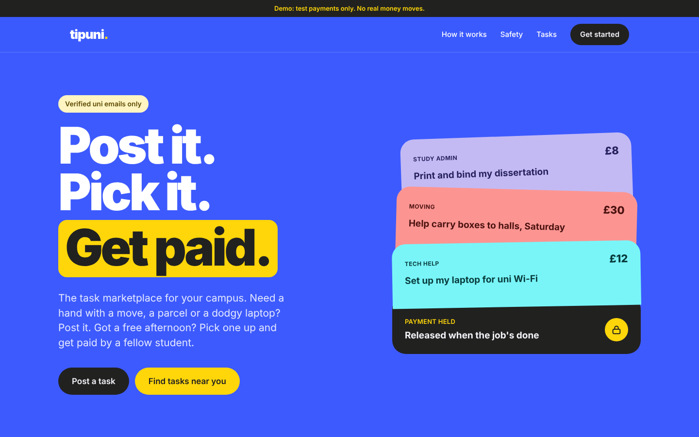
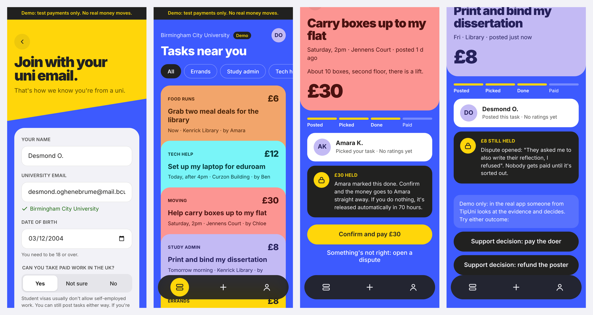

# TipUni

A task marketplace for university students. Post something you need doing
(carry boxes, collect a parcel, fix a laptop), another student picks it up,
and the money is held until you confirm it's done.

> **This is a demo.** No real money moves and no real emails are sent.
> Payments are simulated to follow the flow a real Stripe Connect
> integration would use.





## Why I built it

I work several zero-hours jobs alongside my degree, and the same thing
kept coming up in halls group chats: someone needs a hand with something
small, someone else has a free hour and could use £10, and there's no
safe way to sort the money. Group chats don't hold payments and Airtasker
is built for tradespeople, not students.

The one thing a student-only app can offer that neither of those can is
trust: everyone has signed up with a university email.

## What I changed after reviewing the idea properly

Before building, I wrote a pre-launch review of the risks, and it changed
the product more than I expected:

- **No essay help, at all.** My first design had an "Assignments" category
  with proofreading. In England it's a criminal offence to provide or
  arrange paid contract-cheating services (Skills and Post-16 Education
  Act 2022), so the category became "Study admin" (printing, binding,
  library runs) and posting is screened for writing or editing requests.
- **Work rights are asked up front.** Student visa holders usually can't
  be self-employed, and that includes gig work. Anyone who answers "No" or
  "Not sure" can still post tasks but can't pick up paid ones.
- **18+ only.** Both sides of a payment need to be adults.
- **Money is never just "sent".** It's held when a task is picked,
  released when the poster confirms, released automatically after 72 hours
  if they forget, and frozen if either side opens a dispute.
- **"Verified students" became "verified uni emails".** Staff and
  graduates have .ac.uk addresses too, so the original claim overpromised.

## How a task moves

```
open --pick--> held --mark done--> done --confirm, or 72h--> paid
  |              |                    |
cancel     withdraw / cancel       dispute --> paid or refunded
             (refund)
```

Every step checks who is allowed to do it: you can't pick your own task,
only the doer can mark it done, only the poster can confirm, and a task
can't be picked twice.

## Try it

**Live demo: https://d4smond.github.io/TipUni/** (or open `index.html` locally), then:

1. Sign up with any `.ac.uk` email. The "demo inbox" shows your code.
2. You'll already have one finished task waiting: confirm and pay it, then rate.
3. Post a task. Try "Proofread my essay" to see it refused.
4. On **My tasks**, use **Act as** to switch to Amara, pick your task, mark
   it done, then open a dispute or use **Skip ahead 72 hours** to see the
   automatic payout.

## How it's built

Plain HTML, CSS and JavaScript, no framework, so it runs on GitHub Pages
with nothing to install.

```
index.html          the page shell
css/styles.css      the design: cobalt background, signal yellow, pastel category cards
js/rules.js         all the rules: sign-up checks, post screening, the task lifecycle, ratings
js/store.js         saving to localStorage (stands in for the database)
js/app.js           screens, routing and buttons
js/motion.js        GSAP + Lenis animation, skipped if they don't load or reduced motion is on
tests/              unit tests for rules.js
```

`rules.js` has no idea a web page exists: every function takes plain
objects and returns new ones. That's deliberate, so the same rules can
move to a real backend later without rewriting them.

Money is stored in pence as whole numbers, and the amount held for a task
is worked out from a ledger of hold/release/refund entries rather than
trusted from a field.

Design follows Apple's Human Interface Guidelines where it matters on the
web: the system font (SF Pro on Apple devices), 44pt minimum touch targets,
large titles, and every animation switched off when the user has asked for
reduced motion.

## Tests

```
node --test
```

20 tests on the rules: university email checks (including subdomains and
look-alike domains), the 18+ check around birthdays, essay-request
screening that still allows "print my dissertation", price limits, every
lifecycle transition and who can do it, the 72-hour auto-release, disputes
blocking the auto-release, and ratings.

## What's next

The real version would move to Next.js with Supabase (database, email
sign-in and row-level security) and Stripe Connect in test mode for the
held payments. Before any real launch I'd need written advice from my
university on running a platform while on a Student visa; until then it
stays a demo.

Built by [Desmond Oghenebrume](https://www.linkedin.com/in/desmond-oghenebrume/).
